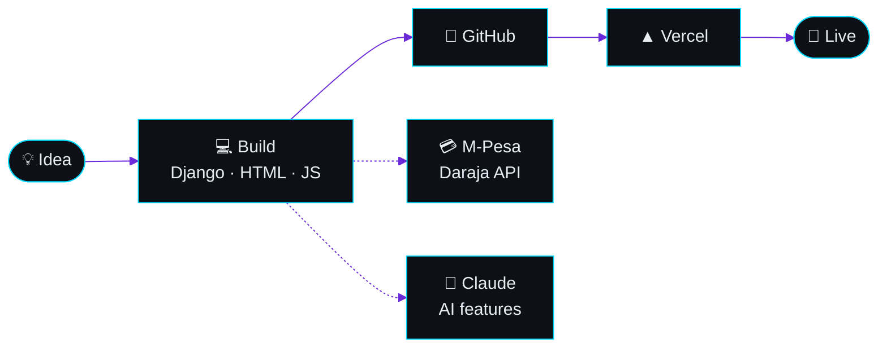

<!-- ───────────────────────────── HEADER ───────────────────────────── -->

<div align="center">


<picture>
  <source media="(prefers-color-scheme: dark)" srcset="https://readme-typing-svg.demolab.com?font=Fira+Code&weight=600&size=22&duration=2800&pause=900&color=00D9FF&center=true&vCenter=true&width=720&height=50&lines=%F0%9F%94%A5+Founder+%40+EddyForge;%F0%9F%90%8D+Django+%2B+Python+Backend+Engineer;%F0%9F%93%A6+Self-Contained+Web+Apps%2C+Zero+Build+Steps;%F0%9F%92%B3+M-Pesa+%26+Daraja+API+Integrations;%F0%9F%A4%96+AI+Features+Powered+by+Claude" />
  
</picture>

<br><br>


</div>

<br>

<!-- ───────────────────────────── WHOAMI ───────────────────────────── -->

## 💻 whoami

```python
class Eddy:
    handle   = "@Edujoew"
    role     = "Founder @ EddyForge"
    stack    = ["Python", "Django", "HTML", "CSS", "JavaScript"]
    approach = "Self-contained web apps, zero build steps"
    payments = "M-Pesa & Safaricom Daraja API"
    ai       = "Claude-powered features"
    ships_to = "GitHub → Vercel"
    learning = ["React", "Java", "PHP", "JavaScript", "Tailwind CSS"]

    def mission(self):
        return "Build Your Digital Legacy"
```

<br>

<!-- ───────────────────────────── WHAT I DO ───────────────────────────── -->

## ⚡ What I Do

<div align="center">
<table>
  <tr>
    <td width="50%" valign="top" align="center">
      <h3>🚀 Fast Sites</h3>
      <p>Shipping client sites that load fast and never break.</p>
    </td>
    <td width="50%" valign="top" align="center">
      <h3>💳 Real Payments</h3>
      <p>Wiring up real <b>M-Pesa</b> payments for Kenyan users. 🇰🇪</p>
    </td>
  </tr>
  <tr>
    <td width="50%" valign="top" align="center">
      <h3>🤖 Claude Inside</h3>
      <p>Dropping <b>Claude-powered chat</b> into plain HTML sites.</p>
    </td>
    <td width="50%" valign="top" align="center">
      <h3>📦 Straight to Prod</h3>
      <p>Deploying straight from <b>GitHub to Vercel</b>.</p>
    </td>
  </tr>
</table>
</div>

<br>

<!-- ───────────────────────────── HOW I SHIP ───────────────────────────── -->

## 🛠️ How I Ship



<div align="center"><sub>Solid line: how code ships. Dotted: what I wire in.</sub></div>

<br>

<!-- ───────────────────────────── TOOLBOX ───────────────────────────── -->

## 🧰 Toolbox

<div align="center">

<br>


<br>

<br>


<br>

<br>


<br>

<br>


<br><br>

<br>
<br>


</div>

<br>

<!-- ───────────────────────────── BUILDING ───────────────────────────── -->

## 🏗️ Building Right Now

<div align="center">
<table>
  <tr>
    <td width="33%" valign="top" align="center">
      <h3>🦅 PLASTOUT</h3>
      <p>Green Eagles Crew<br>Management Platform</p>
      
      
      
    </td>
    <td width="33%" valign="top" align="center">
      <h3>📅 URBS</h3>
      <p>University Resource &amp;<br>Equipment Booking</p>
      
      
      
    </td>
    <td width="33%" valign="top" align="center">
      <h3>🌐 EddyForge Client Sites</h3>
      <p>Fast, Clean,<br>No Build Step</p>
      
      
      
      
    </td>
  </tr>
</table>
</div>

<br>

## 📌 Pinned Projects

<div align="center">
<a href="https://github.com/Edujoew/green_eagles"></a>
<a href="https://github.com/Edujoew/University-Resource-Booking-System-URBS"></a>
</div>

<br>

### 🦅 [PLASTOUT →](https://github.com/Edujoew/green_eagles)

**PLASTOUT** is a community-driven management platform and administrative system for the **Green Eagles Crew** and **Messengers of Peace**, designed to coordinate environmental initiatives, manage scouting patrols, and streamline membership operations.

| Layer | Tools |
|---|---|
| ⚙️ **Backend** | Python, Django, `django_daraja` (M-Pesa API integration), `django-axes` |
| 🎨 **Frontend** | HTML, CSS, JavaScript, Bootstrap 5, Bootstrap Icons |
| 🗄️ **Database** | SQLite / PostgreSQL |
| 🔐 **Security & Auth** | Django Authentication, Role-Based Access Control (RBAC) |

<br>

### 📅 [University Resource & Equipment Booking System →](https://github.com/Edujoew/University-Resource-Booking-System-URBS)

- 🐍 **Django + MariaDB** backend
- 💳 **Safaricom Daraja API** for automated **M-Pesa STK Push**
- ⚡ **Real-time availability** checks

<p align="center"><i>More projects always cooking. Check my pinned repos.</i> 🔥</p>

<br>

<!-- ───────────────────────────── STATS ───────────────────────────── -->

## 📊 GitHub Command Center

<div align="center">

<a href="https://github.com/Edujoew"></a>
<a href="https://github.com/Edujoew/green_eagles"></a>
<a href="https://github.com/Edujoew/green_eagles"></a>
<a href="https://github.com/Edujoew/green_eagles"></a>

<br><br>


<br>


<br><br>


<br>


<br><br>


<br>


<br><br>


<br>


<br><br>


<br>


</div>

<br>

<!-- ───────────────────────────── CONTACT ───────────────────────────── -->

## 📲 Let's Talk

<div align="center">

<b>Need a fast, clean site or a real M-Pesa integration? Let's build it.</b>

<br><br>

<a href="https://linkedin.com/in/johnny-edwards-7b0795393/"></a>
<a href="https://wa.me/254100554588"></a>
<a href="mailto:johnteedushiks247@gmail.com"></a>

</div>

<br>

<!-- ───────────────────────────── FOOTER ───────────────────────────── -->

<div align="center">


<br>


</div>
