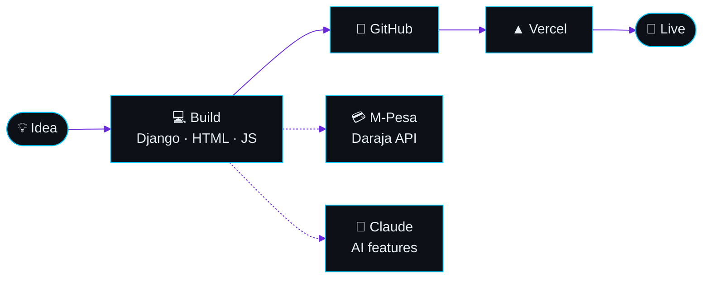

<a name="top"></a>

<div align="center">


<br>


<a href="https://wa.me/254100554588"></a>


</div>

<br>

## `$ ./boot.sh --profile edujoew`

```bash
[  OK  ] Loading identity .............. Edwards John (Dev Eddy)
[  OK  ] Mounting brand ................ EddyForge → "Build Your Digital Legacy"
[  OK  ] Starting backend .............. Python · Django · PostgreSQL
[  OK  ] Starting frontend ............. HTML · CSS · JavaScript · Bootstrap · Tailwind
[  OK  ] Linking payments .............. M-Pesa STK Push · Safaricom Daraja API
[  OK  ] Linking AI .................... Claude-powered chat & features
[  OK  ] Deploy target ................. GitHub → Vercel
[ WAIT ] Compiling new skills .......... React · Java · PHP · Tailwind CSS
[  OK  ] Availability .................. open to client work
```

<br>

## `$ cat about.json`

```json
{
  "handle": "@Edujoew",
  "role": "Founder @ EddyForge",
  "approach": "Self-contained web apps, zero build steps",
  "stack": ["Python", "Django", "HTML", "CSS", "JavaScript"],
  "payments": "M-Pesa & Safaricom Daraja API",
  "ai": "Claude-powered features",
  "ships_to": "GitHub → Vercel",
  "learning": ["React", "Java", "PHP", "JavaScript", "Tailwind CSS"],
  "mission": "Build Your Digital Legacy"
}
```

<br>

## `$ ls services/`

<table>
  <tr>
    <td width="25%" valign="top">
      <br><br>
      Client sites that load fast and never break.
    </td>
    <td width="25%" valign="top">
      <br><br>
      Real <b>M-Pesa</b> payments for Kenyan users. 🇰🇪
    </td>
    <td width="25%" valign="top">
      <br><br>
      <b>Claude-powered chat</b> dropped into plain HTML sites.
    </td>
    <td width="25%" valign="top">
      <br><br>
      Straight from <b>GitHub to Vercel</b>.
    </td>
  </tr>
</table>

<br>

## `$ pipeline --show`



<br>

## `$ npm ls --stack` &nbsp;<sub>(well, `pip freeze`)</sub>

<div align="center">

| | |
|:--|:--|
|  |  |
|  |  |
|  |  |
|  |  |


</div>

<br>

## `$ git log --projects`

<table>
  <tr>
    <td width="50%" valign="top">
      <h3>🦅 <a href="https://github.com/Edujoew/green_eagles">PLASTOUT</a> &nbsp;</h3>
      <p>Community-driven management platform and admin system for the <b>Green Eagles Crew</b> and <b>Messengers of Peace</b>. Coordinates environmental initiatives, scouting patrols and membership operations.</p>
      
      
      
      <br><br>
      <sub><code>django_daraja</code> · <code>django-axes</code> · RBAC · SQLite / PostgreSQL</sub>
    </td>
    <td width="50%" valign="top">
      <h3>📅 <a href="https://github.com/Edujoew/University-Resource-Booking-System-URBS">URBS</a> &nbsp;</h3>
      <p><b>University Resource &amp; Equipment Booking System</b> with real-time availability checks and automated <b>M-Pesa STK Push</b> payments.</p>
      
      
      
      <br><br>
      <sub>Django + MariaDB · Safaricom Daraja API · live availability</sub>
    </td>
  </tr>
  <tr>
    <td colspan="2" valign="top">
      <h3>🌐 EddyForge Client Sites &nbsp;</h3>
      <p>Fast, clean, no build step.</p>
      
      
      
      
    </td>
  </tr>
</table>

<div align="center">
<a href="https://github.com/Edujoew/green_eagles"></a>
<a href="https://github.com/Edujoew/University-Resource-Booking-System-URBS"></a>
</div>

<p align="center"><i>More projects always cooking. Check my pinned repos.</i> 🔥</p>

<br>

## `$ htop --github`

<div align="center">


<br><br>

<!-- STREAK: change the number after &t= (t=2, t=3...) to force a fresh image, GitHub caches images -->


<br><br>


<br>


<br><br>

<picture>
  <source media="(prefers-color-scheme: dark)" srcset="https://raw.githubusercontent.com/Edujoew/Edujoew/output/github-snake-dark.svg" />
  <source media="(prefers-color-scheme: light)" srcset="https://raw.githubusercontent.com/Edujoew/Edujoew/output/github-snake.svg" />
  
</picture>

<sub>A Python snake eating my commits. Rebuilt from my contribution graph every 12 hours.</sub>

</div>

<br>

## `$ ./contact.sh`

> [!TIP]
> **Need a fast, clean site or a real M-Pesa integration? Let's build it.**

<div align="center">

<a href="https://wa.me/254100554588"></a>
<a href="mailto:johnteedushiks247@gmail.com"></a>
<a href="https://linkedin.com/in/johnny-edwards-7b0795393/"></a>

<br><br>


<sub><a href="#top">↑ back to top</a></sub>


</div>
